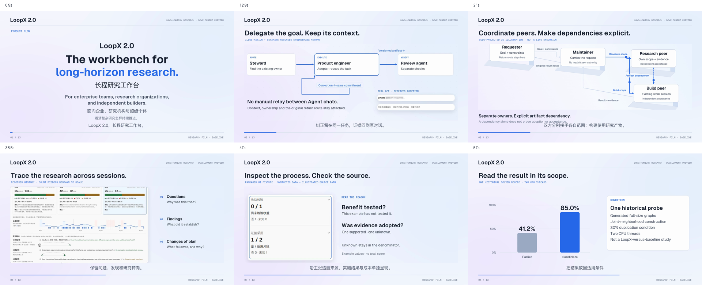

# LoopX 2.0 · Research workbench film

The workbench for long-horizon research. For enterprise teams, research organizations, and independent builders.

[Watch the film · 86.2s](https://github.com/user-attachments/assets/543af0b1-c3d4-4cfb-aedd-a68563a20601) · [Download MP4](loopx-research-workbench.mp4) · [English transcript](loopx-research-workbench.transcript.md) · [中文文字稿](loopx-research-workbench.transcript.zh-CN.md)

[English VTT](loopx-research-workbench.en.vtt) / [SRT](loopx-research-workbench.en.srt) · [中文 VTT](loopx-research-workbench.zh-CN.vtt) / [SRT](loopx-research-workbench.zh-CN.srt) · [简体中文](loopx-research-films.zh-CN.md)

One current film: the A product-flow story, with a 7-second 3D dependency illustration in its delegation chapter. The opening, Kanban, research history, trajectory analysis, measured result and limiting control remain together. English narration and Chinese on-screen subtitles are paired with 19 cues per language. Use fullscreen or the transcript for dense UI details.

## Sources and interpretation

- The recorded-history count ribbons are annotated and redrawn to scale: 2/133 = 1.50% and 1/62 = 1.61% refuted, with counts outside the bands. This corrects the published media, not the running App or the underlying research states.

- The 3D illustration shows separately accepted peer scopes and a research-artifact dependency. It uses a code projection, not Blender or a physical simulation. The separate recorded engineering return and research history are not presented as one execution.
- Kanban and controls use a published workspace scenario. Trajectory analysis uses synthetic packaged-UI data. Its six process judgments are uncalibrated and do not form a total score. Citation paths are illustrated.
- The graph record used two CPU threads and generated full-size joint-neighborhood graphs at 30% partial duplication: accuracy 41.2% → 85.0%. The independent-edge control kept its accuracy while time rose 32%. Native score gain remains unknown. This is not a causal LoopX-versus-baseline result.
- The watermarked Seedance 2.5 concept insert reuses earlier material. No new remote generation or benchmark execution was used for this edit.
- This is a 2.0 development preview. The intended audience does not establish enterprise deployment, security, SLA or multitenancy. Historical 1.0.3 LHTB results keep their original version.

This single version is the production baseline for later creative research. It freezes a comparison artifact, not the story, style, duration or tools of future work. It is not a scientific benchmark or proof of communication benefit. Earlier cuts remain in Git history.

[Historical fixed source](https://github.com/loopx-project/loopx/blob/c9c3adf63f9771ef95f1fcca12b11ed7de1f69eb/apps/presentation/site/public/lab/time-machine/data/graph.json) · [Assessment contract](../../reference/trajectory-assessment.md)
